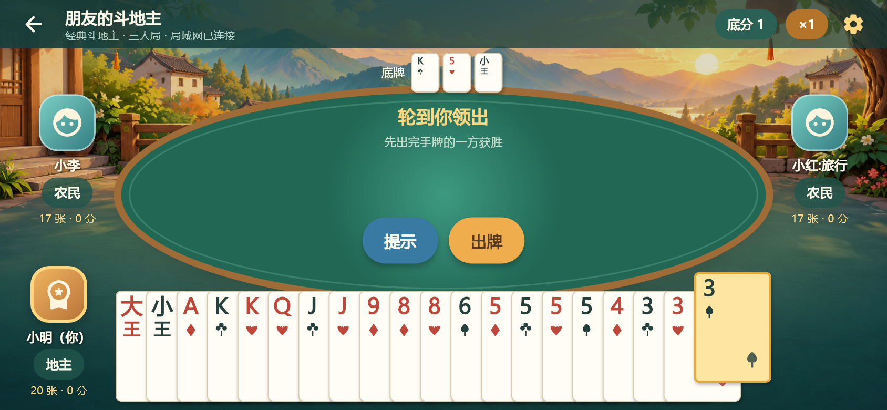

# 一起出牌 · LAN Cards

继续开发前先读 [项目交接记录](docs/HANDOFF.md)；自动化协作规则见根目录 `AGENTS.md`。

面向朋友外出、聚会的开源局域网卡牌 App。**免费、无广告、无账号、无云端牌局服务。**

当前是 **0.2.0 横屏斗地主版**：三人叫抢地主、完整出牌校验、提示、炸弹 / 王炸翻倍、春天 / 反春与零和积分。保留 2–6 人「轮流出牌」测试模块。21 点尚未实现。Android / iOS 原生工程已提供，真机网络兼容性仍需按验收矩阵验证。

当前 Android 安装包：`dist/lan-cards-0.2.0-diagnostics-arm64.apk`，包含局域网诊断，约 20.1 MiB，适用于 Android 7.0+ 的 64 位 ARM 设备。此包对应上次 116 项本机回归，不含最新出牌提示打磨；测试与重新打包延后，见 [验证记录](docs/verification.md)。



## 使用方式

1. 大家提前安装 App，连接同一个 Wi-Fi 或同一个人的手机热点。
2. 一人点击「创建房间」，其他人点击「搜索房间」，点选房间即可坐下。
3. 默认经典斗地主：三位玩家坐满、在线并准备后，由房主开始。
4. 每人 17 张、底牌 3 张，轮流叫地主 / 抢地主；每次抢地主翻倍，确定地主后其获得底牌并先出。
5. 点击或划过手牌多选，再点击出牌；提示只预选合法牌，不会替你自动出牌。

创建房间时也可以选择「轮流出牌 · 框架测试」，用 2–6 人测试房间与网络流程。斗地主具体规则差异见 [规则说明](docs/doudizhu.md)。

互联网不参与牌局通信；软件不负责自动创建热点。网络必须允许设备互通，部分访客 Wi-Fi / 热点可能阻止发现或连接。

## 已实现

- 原创乡村背景、横屏绿色牌桌、左右对手与底部叠放手牌；17 / 20 张手牌、大小王和选牌抬起动画。
- 叫地主、抢地主、首次叫地主者最后反抢、三人不叫自动重新发牌。
- 单张 / 对子 / 三张 / 三带一 / 三带对 / 顺子 / 连对 / 飞机 / 飞机带翅膀 / 四带二 / 炸弹 / 王炸。
- 两家连续不出后恢复领出；地主与农民双人阵营胜负，炸弹、王炸、春天和反春计分。

- 两个首页主入口：创建房间、搜索房间；手动地址只作为备用。
- 原生 DNS-SD/mDNS 服务发布与发现，HTTP 获取最新房间状态。
- WebSocket 主机权威模型，房主自己的操作也通过同一协议验证。
- 座位优先：离线占座，无倒计时，不自动踢人。
- 空位可中途加入，但新人等待下一局，不拿本局手牌。
- 本局参与者离线则暂停，全员恢复后自动继续。
- 系统安全存储保存重连身份，App 启动自动尝试恢复原座位。
- 房主终止本局：作废、不计分、回到原房间，离线座位仍保留。
- 房主踢人：释放座位并撤销旧恢复凭证。
- 单设备单房间、单房间单局。
- 操作去重、旧局操作拒绝、按玩家过滤隐藏手牌。

## 开发环境

项目由 Flutter **3.47.8 / Dart 3.13.7** 生成，依赖版本锁定在 pubspec.lock。

```sh
flutter pub get
dart analyze --format machine lib test tool
flutter test --reporter expanded
flutter run
```

### Android

需要 Android SDK、对应构建工具与 JDK；以 `flutter doctor -v` 为准。

```sh
flutter build apk --debug
```

测试安装包输出为 `build/app/outputs/flutter-apk/app-debug.apk`。这是调试签名包，正式发布需配置自己的签名。

优化包可用 `flutter build apk --release --target-platform android-arm64`，当前工程 release 仍用开发调试证书签名，以便本地测试升级，不是应用商店正式发布签名。

### iPhone

在 macOS 上安装 Xcode，并按 Flutter 的 iOS 开发步骤配置。

```sh
flutter pub get
flutter build ios --debug --no-codesign
```

真机安装时在 Xcode 的 Runner target 配置自己的签名团队。工程已声明本地网络用途、`_lancards._tcp` Bonjour 服务和安全存储所需的 entitlement。不要添加假音频、定位等无关后台模式。

### Windows 开发备注

本仓库只提供 Android / iOS 产品端，不依赖 Windows 桌面构建工具。若某版 Flutter 在含中文的路径执行 `flutter analyze` 时发生工具自身的 LSP 编码异常，可使用上面的 `dart analyze --format machine`；开发者也可以使用 ASCII 工作路径。

Gradle 配置已关闭 Kotlin 增量缓存，避免 Windows 项目目录与 Pub 缓存位于不同盘符时的 `different roots` 构建错误；这不影响运行时功能。

本次开发工具安装在用户 Codex 缓存内，未修改系统 PATH。当前机器可用：

```powershell
& "$env:USERPROFILE\.codex\cache\flutter\bin\flutter.bat" test
```

也提供 `tool/dev.ps1`，会临时映射 ASCII 工作路径，结束后自动撤销映射，不移动文件、不修改系统设置：

```powershell
.\tool\dev.ps1 check
.\tool\dev.ps1 apk
.\tool\dev.ps1 release
```

## 代码结构

```
lib/
  core/       座位、房间、权限、规则接口、随机身份
  games/      斗地主牌型 / 叫抢 / 出牌 / 提示，以及轮流出牌测试规则
  network/    服务发现、WebSocket 主机与客户端
  storage/    本地昵称和安全存储中的恢复凭证
  ui/         首页、搜索、横屏斗地主牌桌、矢量牌面、暂停与恢复提示
  app_controller.dart
test/         领域、真实 Socket、控制器与界面测试
docs/         设计、协议、验收清单及界面预览
```

新游戏实现 GameRules，不需要重写房间、座位或重连逻辑；其退出规则和界面仍需单独实现。

## 当前边界

- 只有原主机进程和牌局仍存在时才能恢复。主机进程结束后重新组房。
- 不保证锁屏或切后台后持续服务；没有后台保活、自动托管或主机迁移。
- 显式离开时如果已经离线，软件无法远程释放原座位，需要原房主手动移出。
- 主机值得信任；首版局域网连接为明文，不提供对恶意房主或网络窃听者的防作弊保证。
- 踢出撤销成员身份，不是硬件封禁。没有账号、房间口令或加入审批。
- iOS 签名、应用商店分发以及 Android/iPhone 热点互通不属于桌面自动测试可以替代的环节。
- 游戏运行不接入 Kimi 或其他模型 API；Kimi K2.6 仅在开发阶段协助生成前端初稿，密钥不写入项目、Git 或安装包。

详细说明：[斗地主规则](docs/doudizhu.md)、[设计约定](docs/architecture.md)、[通信协议](docs/protocol.md)、[测试与真机验收](docs/testing.md)、[美术来源与提示词](assets/README.md)。

## 持续集成与开源

提供 GitHub Actions：静态检查、测试、Android 调试 APK 构建及 iOS 无签名编译。工作流尚需推送到你选择的仓库后实际执行，当前未创建远程仓库或上传代码。

代码采用 MIT License；第三方依赖保留其各自许可证。
